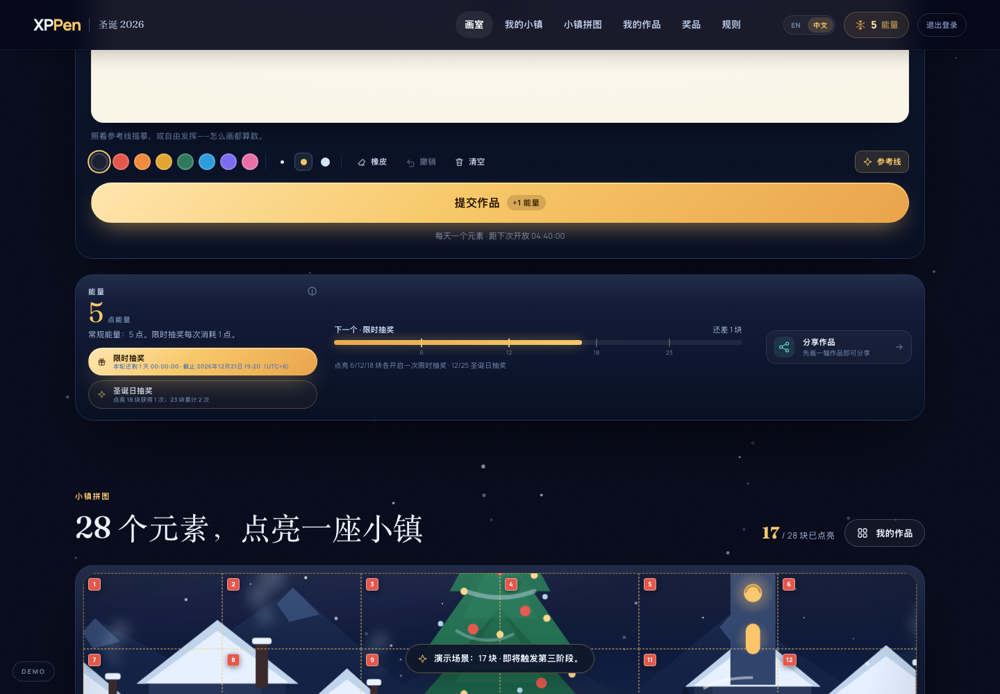
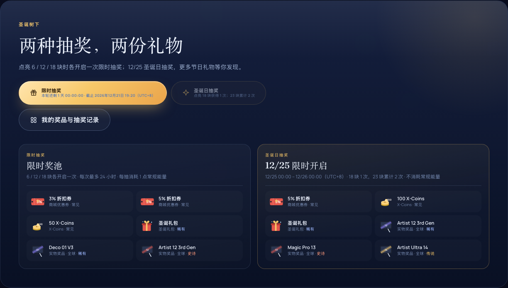
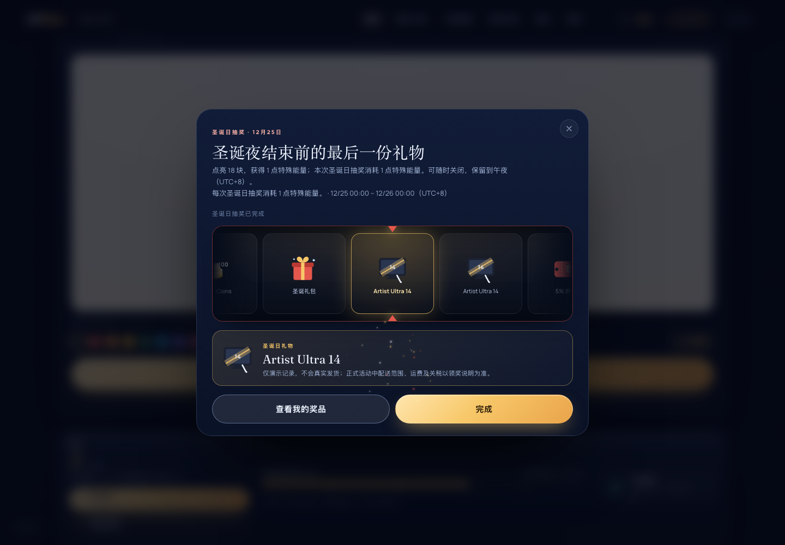
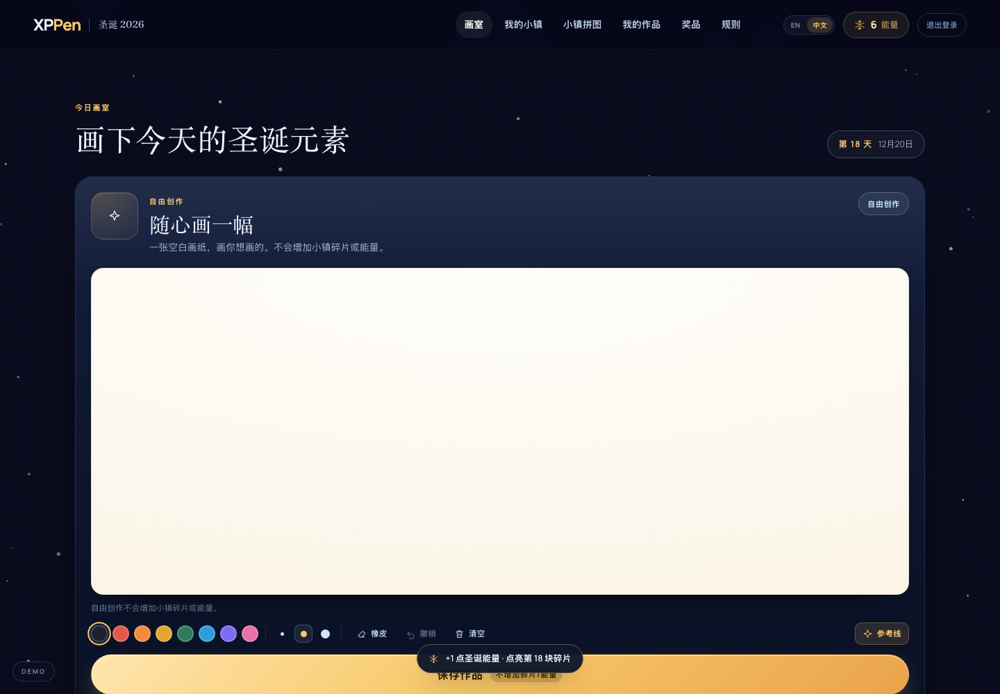
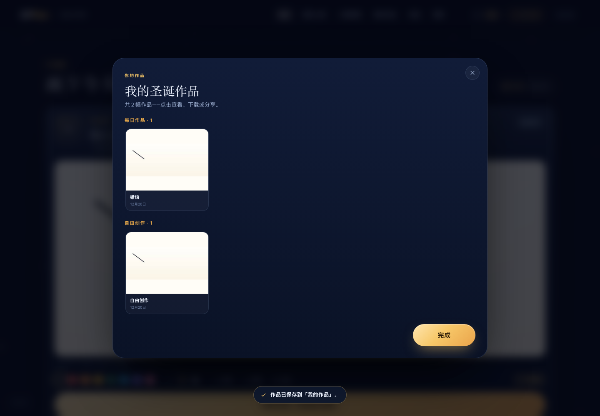
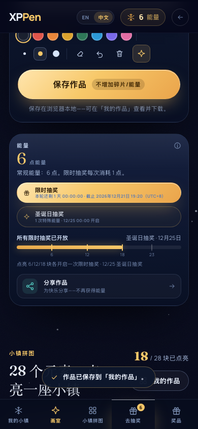

# XPPen Christmas 2026 · 互动游戏页面原型

> **Create the Magic, Give the Joy.**
> 28 天圣诞元素创作 → 点亮小镇碎片 → 6/12/18 限时抽奖 / 12/25 圣诞日抽奖 → 自由创作 → 完整小镇纪念图。
>
> 纯静态前端原型（HTML + CSS + 原生 JS），零构建、零第三方依赖（字体可选），所有插画均为手写内联 SVG，无外链图片。

---

## 1. 快速开始

```bash
cd /Users/guohaoqiu/Projects/圣诞游戏
python3 -m http.server 8777
# 浏览器打开 http://127.0.0.1:8777/
```

> 建议通过本地 HTTP 打开（`localStorage` 在 `file://` 下可能被浏览器禁用）。直接双击 `index.html` 也能运行，但进度可能不持久化。

**单文件版（便于转发 / 双击打开）**

`xppen-christmas-2026-standalone.html` 已把 CSS、JS 全部内联，功能与多文件版一致；双击即可打开。`file://` 下部分浏览器会限制 `localStorage`，此时进度只在当前页面有效，正式预览仍建议用本地 HTTP。

**语言切换（中文 / English）**

- 页面右上角、登录卡片右上角都有 **EN / 中文** 切换；首次访问按浏览器语言自动选择，并记住选择。
- 页面文案、28 个元素、规则、奖品、抽奖弹窗、分享卡和纪念图都会随语言切换；切换时画布上的笔迹会保留。
- 默认按浏览器语言自动识别：`zh-*` 进入中文，其余进入英文。

**演示 / 体验路径**

1. 访客可以直接浏览 Hero、规则、小镇拼图、奖品和「我的作品」入口。
2. 点击画布、开始画作、抽奖入口、我的作品、奖品、纪念图等操作时，才弹出登录弹窗；关闭弹窗仍可浏览。
3. 登录弹窗点击 **Preview with a demo account**（也可用预填账号密码登录），登录后继续刚才被拦截的操作。
4. 默认演示状态为 **2026-12-03 10:30（UTC+8）**，0 块碎片 / 0 点能量；左下角 **DEMO** 悬浮按钮可切换时间与场景。
5. 30 秒路径：DEMO 选 **17 pieces · Stage 3 next** → 画第 18 块 → 结果弹窗显示「圣诞日抽奖资格已获得 / 限时抽奖已开启」→ 去限时抽奖 → 12/25 场景下再体验圣诞日抽奖。
6. 登录后顶栏右侧出现 **Sign out / 退出**（移动端为图标按钮）；退出只清除模拟登录态，不清除本机作品、能量和奖品记录。

**演示场景（Demo controls）**

| 场景 | 时间 | 状态 |
| --- | --- | --- |
| Fresh account | 12/3 10:30 | 全新账号，0 块 / 0 能量 |
| 5 pieces · Stage 1 next | 12/8 19:20 | 5 块 + 5 能量，画第 6 块开启第一段限时窗口 |
| 17 pieces · Stage 3 next | 12/20 | 第一/二段窗口已过期，画第 18 块开启第三段限时窗口 |
| Christmas Day · 18 pieces | 12/25 12:00 | 圣诞日抽奖 1 次（1 点特殊能量），限时入口同时开放 |
| Make-up day · 20 pieces | 12/27 | 补画期，选中一个未完成历史任务；补画不增加能量 |
| Make-up · 5 pieces → Stage 1 | 12/27 | 选中历史任务，补画第 6 块会开启限时窗口，但不增加能量 |
| Full town · 28 pieces | 12/30 | 完整小镇，可生成纪念图 |

> 补画场景会自动选中一个未完成历史任务，直接提交即可验证「补画不加能量」；也可以在 Studio 顶部的 Make-up 任务条切换。

---

## 2. 页面与信息架构

### 桌面端（≥1040px）

```
固定顶栏（Logo / 导航 / EN·中文 / 能量 / 登录后的退出按钮）
├─ Hero        品牌主张 + 小镇雪景（28 块冰封碎片）+ 能量/小镇碎片
├─ Studio      今日主题 / 补画任务 + 全宽画板 + 工具 + 提交；画板下方 HUD 含两个抽奖入口
├─ Collection  28 块编号小镇拼图（锁定碎片 + 右下角进度木牌，点击已点亮碎片查看作品）
├─ Gifts       两种抽奖说明 + 两个奖池 + My Prizes 入口
└─ Footer      规则 / 官方邮箱 / 数字纪念品说明
```

### 移动端（≤900px）

- 单列布局、底部 Tab（Town / Studio / Collection / Draw / Prizes）；
- 顶栏保留语言、能量和退出图标；抽奖双入口在 Studio HUD 内；
- 抽奖、规则、纪念图等弹窗改为底部抽屉；
- 画布为 1:1，工具栏两行排布，适配安全区（`env(safe-area-inset-*)`）。

### 弹窗 / 浮层

登录 → 规则 → 限时抽奖 / 圣诞日抽奖 → 奖品记录 → 作品详情 → 自由创作保存成功/失败 → 分享卡 → 纪念图 → 小镇完成庆祝。

> 本版没有顶部头像，也没有全屏登录拦截；登录只作为操作门槛，访客始终可以浏览活动详情。

---

## 3. 玩法实现（R01–R12 + 自由创作）

| 需求 | 原型实现 | 备注 |
| --- | --- | --- |
| **R01 时间与访问** | 2026-12-03 10:00 → 12-31 10:00（UTC+8）；28 个任务 12/3–12/30 每天开放（第 1 天 10:00，其余 00:00）；结束后只读 | 所有时间按 UTC+8 |
| **R02 账号与登录** | 访客可浏览；画布/提交/抽奖/作品/奖品/纪念图/分享等操作触发登录弹窗，登录后继续原操作；模拟账号写 `localStorage`；登录后顶栏显示退出 | 无真实 SSO；退出不清演示数据 |
| **R03 每日主题与画板** | 28 个主题；12/3–12/30 每天开放 1 个；12/26 起可补画历史任务；空白提交拦截；8 色 / 3 档粗细 / 橡皮 / 撤销 / 清空二次确认 / 参考线 | 补画不增加能量 |
| **R04 能量与小镇** | 每日首次绘画 +1 碎片；完成时碎片 ≤18 才 +1 常规能量（第 18 块仍 +1，19–28 不加）；补画 +1 碎片不加能量；能量为全局抽奖余额；分享每日首次 +1（18 块前） | 常规能量与特殊能量独立 |
| **R05 限时抽奖** | 单一奖池；6/12/18 块各开启一次，每次 24 小时；重叠时以最晚结束的窗口为准；最晚不超过 12/31 10:00；窗口内所有常规能量可用，每抽消耗 1 点；每次点击重新校验时间/余额/登录 | 无阶段选择；记录来源「限时抽奖」 |
| **R06 圣诞日抽奖** | 仅 12/25 00:00（含）–12/26 00:00（不含）；18 块得 1 点、23 块累计 2 点特殊能量；每抽消耗 1 点特殊能量，不消耗常规能量；独立奖池与入口 | 资格独立于常规能量；每次点击重新校验 |
| **R07 补画** | 12/26 00:00–12/31 10:00；任意已开放未完成任务可不限数量补画；+1 碎片、不加能量；可完成 6/12/18 门槛并开启限时窗口；不阻塞继续补画 | 不在 12/25 提供补画入口 |
| **R08 完整小镇与纪念图** | 28 块后生成 1200×1500 PNG：昵称 + 圣诞祝福 + 唯一编号 + 完整小镇；可下载 | 编号 `XM26-XXXX-XXXX`；前端占位生成 |
| **R09 奖品与记录** | My Prizes 列表、来源/日期、券码复制、实物演示领取说明、空态；奖品全部标注为演示记录 | 概率/库存/履约需运营与后端确认 |
| **R10 分享与承接** | 每日首次 +1 能量（18 块前）；未完成只能分享单幅作品卡，28 块完成后才能分享完整小镇；支持 `navigator.share`，不支持时下载 PNG | 点击即计 |
| **R11 展示与动效** | 飘雪、能量飞入、碎片点亮/闪光、抽奖光轨、礼花、小镇完成庆祝、Toast、规则文案 | 视觉稿以此原型为准再迭代 |
| **R12 指标** | 前端未接埋点 | 建议事件见 §7 |
| **自由创作** | 空白画布，明确标注「自由创作 / 不增加碎片或能量」；保存为独立作品，进入 My Works 的 FREE CREATIONS 分组；可下载；无编辑入口；不覆盖每日任务作品 | 保存失败必须显式提示，保留画布并可下载 |

---

## 4. 已确认规则与关键边界

1. **限时抽奖只有一个奖池**：6/12/18 是三个门槛，每个门槛到达时各开启一次 24 小时窗口，不存在 Stage One/Two/Three 三套奖池。
2. **窗口计算**：每个节点的结束时间 = min(达成时间 + 24h, 活动结束 12/31 10:00)；多个窗口重叠时，以最晚未结束窗口的结束时间为准；开始时间含、结束时间不含。
3. **窗口内能量**：窗口期间获得的常规能量也可使用；未用完的能量保留到后续窗口；没有能量时入口仍显示倒计时，获得能量后恢复。
4. **每次点击重新校验**：登录态、当前窗口、常规能量/特殊能量在每次「抽一次」时重新检查；弹窗打开时在窗口内、点击时已过截止，不扣能量、不写记录。
5. **圣诞日边界**：12/25 00:00（含）至 12/26 00:00（不含）；18 块 = 1 点、23 块累计 = 2 点特殊能量；特殊抽奖不扣常规能量。
6. **结果弹窗优先级**：本次新获得圣诞日资格 > 本次新开启限时窗口 > 普通提交；同一提交两者都有时，圣诞日优先，同一弹窗同时展示限时窗口和实际截止时间；圣诞日未到 12/25 时标题为「资格已获得」，主按钮去限时抽奖。
7. **28 块**：只展示完整小镇庆祝，不再叠加提交结果弹窗；刷新不重复。
8. **自由创作**：不增加碎片、能量、窗口或圣诞日资格；保存到 My Works，和每日作品分组展示；无编辑/删除入口。
9. **退出**：只清除模拟登录态，保留本机作品、能量、奖品；退出后需要重新登录才能继续受保护操作。
10. **演示数据**：使用新的 `xppen-xmas-2026-v2` key，不迁移旧 `v1` 数据；默认全新演示状态，旧数据不会混入。

### 仍待确认（不阻塞原型，阻塞上线）

- 第 28 块完成时若同时获得其他权益，庆祝弹窗如何叠加：当前只庆祝，不叠加结果弹窗。
- 自由创作保存成功后画布清空还是保留：当前保留画布并提示已保存，不伪造成功。
- HANDOFF 写补画从 12/26 开始，又说补画计入 12/25 圣诞日资格；两者矛盾。当前不在 12/25 提供补画入口，补画无法影响已结束的圣诞日窗口。

---

## 5. 状态机与关键实现

**状态模型**（`localStorage` key：`xppen-xmas-2026-v2`）

```js
{
  v: 3,
  user, sim,                       // 模拟登录 / 模拟时间
  completed: { taskId: { at, makeup, art } },
  energy,                          // 常规能量余额
  nodes: {                         // 每个门槛的达成与窗口结束
    stage1|stage2|stage3: { achievedAt, endAt }
  },
  special: { chances, used },      // 圣诞日特殊能量上限（18/23）与已用
  freeWorks: [ { id, art, at } ],  // 自由创作，独立于每日任务
  prizes: [ { uid, name, kind, code, at, source, ... } ],
  share: { day, count },
  keepsake: { name, blessing, code, createdAt },
  seen: { complete },
  ui: { filter, selectedId, justSubmitted }
}
```

- `limitedWindow()`：汇总所有已达成节点的 `endAt`，取最晚一个；返回 `{ node, end, open, expired }`。
- `drawEntryState('limited'|'special')`：只负责入口状态（not open / open countdown / no energy / ended / locked / used），UI 与抽奖函数都从它取状态。
- `openLimitedDraw()` / `openSpecialDraw()`：每次 spin 前重新校验；扣减对应能量；写入 `source: 'limited' | 'special'`。
- `openResultModal()`：`specialOpenNow` 与 `limitedNew` 决定标题、说明行和主按钮；只有圣诞日窗口真正开放时才把主按钮指向圣诞日抽奖。
- `submitDrawing()`：每日/补画/自由创作三条路径；自由创作保存失败时不写记录、不清画布、打开失败弹窗并提供下载。
- `openWorks()`：每日作品与自由创作分组；自由创作只读查看 + 下载，没有编辑入口。

**构建 / 版本**

- 本地 CSS/JS 通过 `?v=20261101c` 版本号引用；改动资源后必须同步 bump，避免旧缓存。
- 单文件版由 `index.html` 内联 CSS 与全部 JS 生成；改完多文件版后需要重新构建。
- 详细交接与历史问题见 `HANDOFF.md`（注：HANDOFF 早于本版 Spec，部分内容已过时）。

---

## 6. 文件结构

```
圣诞游戏/
├─ index.html                 页面骨架、静态文案、图标 symbol
├─ xppen-christmas-2026-standalone.html   单文件构建（内联 CSS/JS）
├─ assets/
│  ├─ css/style.css           设计系统 + 桌面/移动端布局 + 动效
│  └─ js/
│     ├─ i18n.js              中英双语字典、静态文案替换、语言切换
│     ├─ data.js              28 个任务、里程碑、限时/特殊奖池、规则文案
│     ├─ art.js               小镇场景 SVG、28 个元素图标、奖品图标
│     ├─ draw.js              画板（笔迹、撤销、导出）
│     ├─ reel.js              抽奖光轨组件
│     ├─ keepsake.js          纪念图 / 分享卡 Canvas 合成与下载
│     └─ app.js               状态机、双抽奖入口、结果弹窗、自由创作、分享、Demo
├─ docs/screenshots/          交付截图
├─ 圣诞活动原型调整 Spec.md   本版需求说明（已确认）
├─ HANDOFF.md                 代码交接与历史问题（部分过时）
└─ README.md
```

---

## 7. 后端接入建议（原型未实现）

| 能力 | 建议接口 | 关键点 |
| --- | --- | --- |
| 进度读取 | `GET /api/xmas/profile` | 返回 completed、energy、nodes（achievedAt/endAt）、special、freeWorks、prizes |
| 提交作品 | `POST /api/xmas/draw` | 服务端校验空白/重复/日期/每日限次/补画；落库存图；返回最新进度、是否开启窗口、是否新获得圣诞日资格 |
| 限时抽奖 | `POST /api/xmas/draws/limited` | **服务端抽奖**、校验当前有效窗口与常规能量、扣 1 能量、写记录；幂等键防重复 |
| 圣诞日抽奖 | `POST /api/xmas/draws/special` | 校验 12/25 窗口与特殊能量、扣 1 特殊能量、写记录；服务端生成概率 |
| 自由创作 | `POST /api/xmas/free-works` | 独立存储、限流、失败明确返回；不参与碎片/能量/窗口 |
| 分享计次 | `POST /api/xmas/share` | 服务端按 UTC+8 判重，防刷；返回是否 +1 |
| 退出 | `POST /api/xmas/logout` | 清除服务端会话；前端本机演示数据是否保留由产品确认 |
| 奖品记录 | `GET /api/xmas/prizes` | 券码/积分/实物状态与履约信息；正式环境不得由前端决定中奖 |
| 纪念图 | `POST /api/xmas/keepsake` | 唯一编号由服务端分配，禁止前端自增 |

建议埋点：`page_view`、`login_success`、`logout`、`task_open`、`draw_submit`、`piece_unlock`、`limited_window_open`、`limited_draw_spin`、`special_draw_spin`、`prize_win`、`free_work_save`、`free_work_save_fail`、`share_click`、`share_success`、`keepsake_download`、`makeup_submit`。

---

## 8. 已知限制

- 无真实账号、登录态、抽奖、库存、发奖、分享回调；所有写操作仅在本机 `localStorage`。
- 奖品概率与库存为演示数据，上线必须服务端化，前端不应参与中奖计算；所有奖品文案均标注为演示记录。
- `localStorage` 容量有限（约 5MB）；本原型只存 480px JPEG 缩略图，28 张约 0.5MB；自由创作也占同一配额。
- Web Share API 在部分桌面浏览器不可用，已降级为下载 PNG。
- 纪念图编号、昵称/祝福敏感词校验、分享判定、SSO、跨设备进度均为待接入项。
- 移动端底部 Tab 的 Draw 入口只指向限时抽奖；圣诞日入口在 Studio HUD，属于有意的布局取舍。

---

## 9. 验收自测清单

- [x] 活动前进入 → Studio 显示活动未开始，不可提交
- [x] 12/31 10:00 后进入 → 只读，抽奖入口关闭
- [x] 空白画布提交 → 拦截并抖动提示
- [x] 第 1 个每日任务 → +1 能量 +1 碎片
- [x] 第 6 / 18 块 → 限时窗口开启，结果弹窗显示实际截止时间
- [x] 第 18 块在 12/20 → 圣诞日资格提示，主按钮去限时抽奖（不误开圣诞日抽奖）
- [x] 12/25 同一提交到 18 块 → 圣诞日优先，同一弹窗展示限时窗口
- [x] 12/25 23 块 → 特殊能量累计 2 点，常规能量不扣
- [x] 限时窗口 0 能量 → 入口显示无能量、不可抽；获得能量后恢复
- [x] 限时窗口重叠 → 取最晚结束时间；前一段过期后后一段仍可抽
- [x] 12/26 00:00 → 圣诞日入口关闭；12/31 10:00 → 限时入口关闭
- [x] 12/31 09:30 达成节点 → 窗口截止 10:00；10:00 点击不可抽
- [x] 补画 → +1 碎片、不加能量；可开启限时窗口
- [x] 自由创作 → 空白画布、不增加碎片/能量、保存到 My Works、可下载
- [x] 自由创作保存失败 → 明确失败、保留画布、可下载，不产生成功记录
- [x] 28 块 → 只庆祝一次，刷新不重复
- [x] 访客 → 可浏览；点击操作弹登录；登录后继续原操作
- [x] 退出 → 只清登录态，作品/能量/奖品保留；重新登录数据仍在
- [x] 1440 桌面 → 双入口 HUD、双奖池、无横向溢出
- [x] 390 移动端 → 双入口 HUD、单列、底部 Tab、无横向溢出
- [ ] 完整 EN/ZH 文案与所有弹窗的英文校对（部分已验证，待最终走查）
- [x] 单文件版与多文件版最终一致性（构建后 file:// 冒烟通过）
- [x] 抽奖弹窗内「抽一次」在窗口最后一秒的点击边界（可控时钟验证：限时 12/31 10:00、圣诞日 12/26 00:00 均不扣能量）

---

## 10. 截图

| 抽奖双入口 HUD | 两种抽奖 / 两个奖池 |
| --- | --- |
|  |  |

| 限时窗口开启结果 | 圣诞日抽奖 |
| --- | --- |
|  |  |

| 自由创作 | 我的作品（每日 / 自由创作） |
| --- | --- |
|  |  |

| 登录弹窗（访客可关闭） | 移动端 HUD |
| --- | --- |
|  |  |

> 早期截图（阶段奖池、旧抽奖入口、旧补画触发）已不代表当前实现；以本表与最新页面为准。
