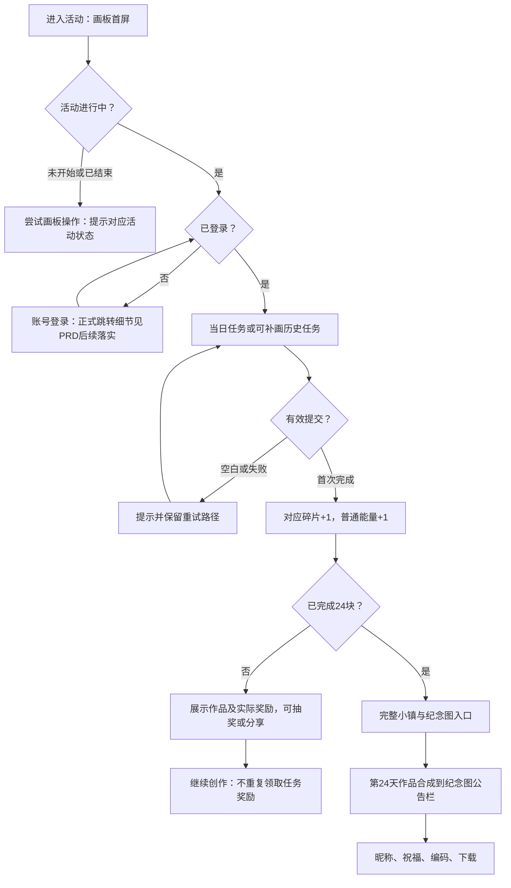
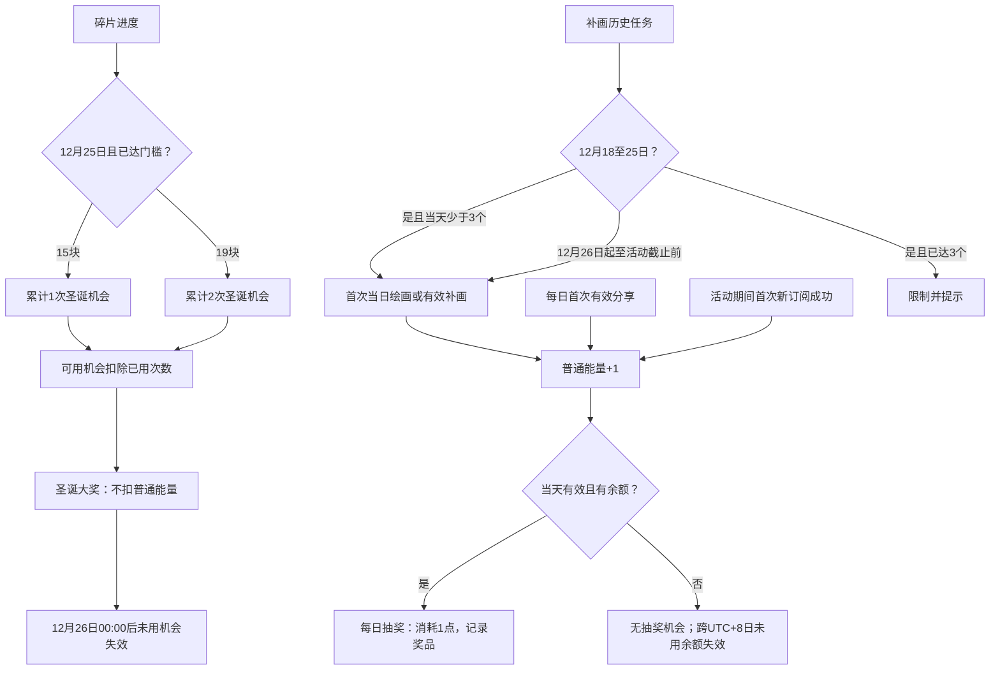
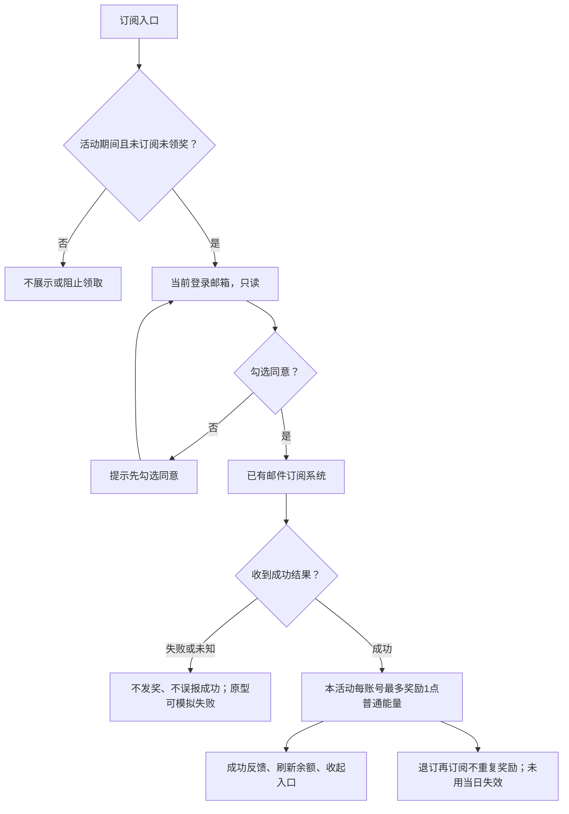
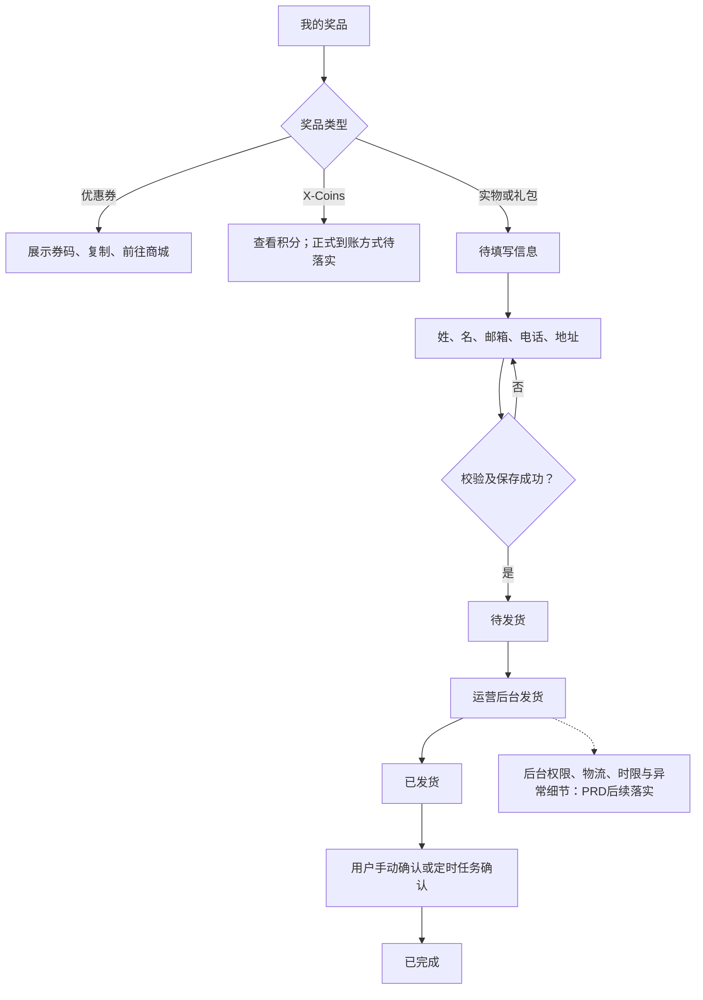

# 圣诞活动批注 PRD

## 主页面批注

### [1] 活动入口、登录、时段与全局依据

来源章节：PRD 1—4、5.1、8—9；A01

聚合范围：活动导航、登录、活动前后拦截、语言、资料来源和通用落实事项

## 1. 文档信息

| 项目 | 内容 |
| --- | --- |
| 版本号 | v1.0 |
| 日期 | 2026-11-05 |
| 状态 | 待评审；不代表正式系统已实现或已上线 |
| 读者 | 产品、设计、研发、测试、运营 |
| 适用端 | 官网活动页面；运营发货涉及后台，具体后台方案待评审 |

### 1.1 材料及证据约定

- **S1｜业务方案**：[2026 官网圣诞游戏方案 2026 年 11 月 03 日](业务资料_副本/2026官网圣诞游戏方案2026年11月03日.pdf)，第 3 部分游戏方案及第 7 部分活动规则。该版本使用 28 天、18／23 门槛，部分规则与后续决定冲突。
- **S2｜历史规则整理**：[业务规则调整 Spec（2026-11-03）](圣诞活动业务规则调整%20Spec（2026-11-03）.md)，为待评审稿，不是上线证明；其中日期、数量和门槛已被后续决定替代。
- **S3｜后续业务确认**：本会话中用户对业务规则、页面批注和澄清的明确回复，见各项对应标注；最终应以评审纪要或更新后的业务方案归档。其晚于 S1、S2，冲突时作为本稿基线。
- **S4｜原型观察**：[原型入口](index.html)、[规则及奖池数据](assets/js/data.js)、[页面行为](assets/js/app.js)、[中英文文案](assets/js/i18n.js)、[纪念图合成](assets/js/keepsake.js)。原型仅证明演示设计，不代表接口、奖励或发货已真实接入。

以下使用「已确认」表示 S3 明确给出的决定；「原型观察」表示 S4 当前行为；「待确认」表示材料不足或正式实现仍需确认。凡未明确提及的技术方案不作为既定需求。

## 2. 背景、目标与角色

S1 的目标是借圣诞创作活动提升官网参与、回访、品牌传播和商城导流。活动主题为 **Create the Magic, Give the Joy**。业务目标属于方案意图，不等于已完成结果。

| 角色 | 场景 |
| --- | --- |
| 访客 | 浏览活动，尝试参与时完成登录；具体登录接入待确认 |
| 登录用户 | 绘画、补画、分享、订阅、抽奖、查看奖品及生成纪念图 |
| 运营 | 配置和发放奖品、处理实物发货；后台能力与权限待确认 |

## 3. 需求范围与业务流程

本次范围：活动页面、24 个每日绘画任务、补画、小镇进度、每日抽奖、圣诞大奖、分享奖励、邮件订阅奖励、作品、奖品领取状态、纪念图及中英文展示。S3、S4。

流程：进入活动 → 登录 → 完成当日任务或可补画任务 → 获得碎片和能量 → 当日参与抽奖；分享及新订阅可按资格获得额外能量 → 查看与领取奖品。集齐 24 块后，可生成并下载包含第 24 天画作的纪念图。12 月 25 日符合碎片门槛时可参与独立大奖池。

正式邮件系统、账号系统、奖品库存与发放、运营后台、物流和社交分享渠道属于外部依赖；接口、归属和交付范围待评审。原型中的模拟逻辑不构成正式接口交付承诺。

## 4. 已确认业务基线

| 项目 | 规则 | 来源及状态 |
| --- | --- | --- |
| 活动时间 | 2026-12-07 10:00 至 2026-12-31 10:00，UTC+8；截止时不能继续创作提交或补画 | S3 确认从 12 月 7 日起共 24 个任务及 12 月 31 日 10:00 截止；S4 `EVENT` |
| 每日主题 | 12 月 7 日至 30 日依次开放原先第 1—24 个主题；第 24 天为雪橇 | S3 对主题取舍的明确回复；S4 `TASKS` |
| 碎片及能量 | 首次完成当日任务获得 1 块对应碎片和 1 点能量；完成此前未完成任务的有效补画也获得对应碎片与 1 点能量；同一任务不重复发放 | S3 对能量和补画的确认；S2「活动和任务」 |
| 补画 | 12 月 18—25 日每天最多 3 个；12 月 26 日起至活动截止前不限每日数量；仅补已开放且未完成的历史任务，日期按 UTC+8 计算 | S2「活动和任务」及验收场景；活动时区和截止时间见 S3、S4 |
| 普通能量 | 1 点能量对应 1 次普通抽奖；当日未用完于 UTC+8 次日失效，不累计 | S3 明确确认；S4 `energy()` |
| 分享 | 当日首次分享任意已完成的活动画作（包含历史及补画作品），成功打开分享渠道后增加 1 点能量；当日重复分享不重复奖励 | S3 对作品范围及成功判定的确认 |
| 邮件订阅 | 活动期间当前登录用户新订阅成功，获得 1 点普通能量，当日未使用失效；原本已订阅不补发，每个账号本活动最多领取一次，退订后重新订阅不重复发放；仅取登录邮箱且不可编辑；系统成功结果后发奖 | S3 订阅资格、邮箱、能量有效期及成功结果确认；[邮件订阅奖励调整 Spec](邮件订阅奖励调整%20Spec.md) 第 4 节已确认重复订阅不重复发奖；S4 为模拟实现 |
| 圣诞大奖 | 12 月 25 日 00:00 至 12 月 26 日 00:00（UTC+8）；达到 15 块获得 1 次，达到 19 块累计 2 次；25 日当天达到门槛即时获得机会 | S3 明确将 18／23 同步改为 15／19；S4 `SPECIAL` |
| 纪念图 | 集齐 24 块后，可使用昵称、祝福及编码生成纪念图；第 24 天画作自动融入小镇公告栏，仅影响纪念图合成，不改变活动页拼图 | S3 对第 24 天画作、公告栏和展示范围的确认；S4 `openKeepsake()` |
| 实物领奖 | 填写信息后待发货；运营发货后已发货；用户手动确认或定时任务确认后已完成 | S3 对奖品状态与确认方式的明确回复 |

**冲突处理**：S1 的 28 个主题、18／23 块门槛、补画不加能量、订阅奖励进入大奖池，以及能量累计描述，均与 S3 后续确认冲突，本稿不作为当前基线。建议业务更新原始方案及对外规则。S1 的目标数字为原方案目标，统计口径尚未完全确定，本稿不将其作为已确认验收指标。

### 5.1 活动页面、登录与活动状态

- 页面进入后首先展示画板，提供圣诞小镇、抽奖、我的作品、我的奖品及规则入口。S3 页面批注。
- 访客浏览页面；绘画、提交及账户相关操作需登录。S1「游戏流程」；S4 为模拟登录，正式登录与注册跳转、登录后恢复动作待确认。
- 活动未开始或结束时不以整屏状态页替换画板；用户尝试绘画或提交等画板操作时，弹窗提示「活动未开始」或「活动已结束」。S3 明确要求；原型弹窗保留下方关闭按钮。
- 中英文可切换，交互状态不应因切换丢失；具体文案以业务确认版本为准。S4；用户对中英文文案的批注。

## 6. 关键字段与状态

| 字段 | 类型／必填 | 来源与更新节点 | 规则及权限 | 空值、异常及待确认 |
| --- | --- | --- | --- | --- |
| 账号标识 | 标识／参与用户必需 | 登录账号系统；登录时识别 | 进度和奖励归属当前账号；用户仅查看自身信息 | 正式身份、跨端同步及退出行为待确认；S1、S3 |

## 7. 验收条件

| 编号 | 前置条件 | 操作 | 可观察预期 |
| --- | --- | --- | --- |
| A01 | UTC+8 时间在活动开始前或结束后 | 点击画板、绘画工具或提交 | 画板仍显示；弹出对应活动未开始或已结束提示，未产生作品、碎片或奖励 |

## 7. 验收条件

| 编号 | 前置条件 | 操作 | 可观察预期 |
| --- | --- | --- | --- |
| A01 | UTC+8 时间在活动开始前或结束后 | 点击画板、绘画工具或提交 | 画板仍显示；弹出对应活动未开始或已结束提示，未产生作品、碎片或奖励 |
| A02 | 活动进行中，已登录，当天任务未完成 | 绘画并首次提交 | 对应任务完成、碎片 +1、普通能量 +1；成功反馈展示作品 |
| A03 | 当日任务已完成 | 再次自由创作并提交 | 作品保存；原任务碎片与任务能量不重复增加 |
| A04 | 12 月 18—25 日，当日已完成 3 次补画 | 尝试第 4 次补画 | 阻止补画并提示限制；次日重新计算 |
| A05 | 12 月 26 日至活动截止前，存在已开放未完成的历史任务 | 完成有效补画 | 对应碎片 +1、普通能量 +1；不受每日 3 次限制 |
| A06 | 普通能量余额为 2 | 当日完成 1 次普通抽奖，再跨 UTC+8 日界 | 抽奖后余额为 1；跨日未使用余额失效，不累加次日 |
| A07 | 当天未获得分享奖励，有已完成的历史或补画作品 | 成功打开分享渠道，再重复分享 | 首次普通能量 +1；重复分享不再增加 |
| A08 | 活动期间登录用户未订阅、未获奖励 | 不勾选同意提交；随后勾选且收到订阅成功结果 | 未勾选时阻止；成功后普通能量 +1，入口按资格收起；原型仅模拟结果 |
| A09 | 12 月 25 日，用户分别有 14、18 块碎片 | 完成有效任务达到 15、19 块 | 达到 15 块累计获 1 次大奖机会；达到 19 块累计 2 次；可用次数扣除已使用次数 |
| A10 | 圣诞机会有余额，时间到 12 月 26 日 00:00 UTC+8 | 进入大奖 | 不再可使用该机会；普通能量余额不因此被扣减 |
| A11 | 实物奖品待填写 | 填写有效信息并保存，运营发货后用户确认 | 状态依次为待发货、已发货、已完成；自动确认路径及具体时限待确认 |
| A12 | 已点亮 24 块且第 24 天作品存在 | 打开纪念图并生成 | 展示编码及第 24 天作品；合成图使用相同编码和画作；活动页拼图不变 |

上述为评审验收目标，并非本次对正式系统或所有浏览器状态的测试结论。正式验收还需补充服务端幂等、数据一致性、失败恢复、设备与浏览器覆盖。

## 8. 已确认事项与后续落实

以下事项拆分为已有业务结论和落地工作；涉及技术、运营或法务工作不表示原业务规则未确认。

1. **活动与补画边界（已确认）**：活动从 12 月 7 日 10:00 至 12 月 31 日 10:00（UTC+8）；12 月 18—25 日每天最多补画 3 个，12 月 26 日至活动截止前不限每日数量。12 月 7 日后的每日主题在原型中于 UTC+8 00:00 开放，正式开放时刻可由业务资料进一步核对。S2、S3、S4。
2. **订阅奖励（已确认）**：活动期间新订阅获得 1 点普通能量，未使用当日失效；原本已订阅不补发；每账号活动期间最多领取一次，退订再订阅不重复发放。S3；[邮件订阅奖励调整 Spec](邮件订阅奖励调整%20Spec.md) 第 4 节。
3. **分享奖励（已确认）**：每日首次分享已完成的活动画作，成功打开渠道后获得 1 点能量；历史画作及补画均可。渠道成功状态的技术识别、取消和重复回调处理属于实现工作；自由创作是否计奖的依据需核对。S3。
4. **奖池与履约（落地工作）**：确认并配置奖品、库存、概率、优惠券及配送细则，并对照 S1 的地区限制、税费和补偿条款；本稿未找到完整的后续最终配置记录，需查阅已确认材料，不能直接认定尚未确认。
5. **实物订单与后台（已确认状态，需落实细节）**：待发货 → 已发货 → 已完成；用户可手动确认或由定时任务确认。收件字段、后台权限、物流信息、自动确认时点和异常审计需查阅对应已确认资料并落地。S3。
6. **纪念图（已确认展示，需落实细节）**：第 24 天画作融入纪念图中的小镇公告栏，不改变活动页拼图；展示编码。编码持久化、作品版本、下载分享及审核的详细设计需查阅已确认资料并落地。S3。
7. **系统与指标（落地工作）**：对接账号、邮件、抽奖、奖品、作品和分享系统，核对埋点、统计口径、授权及数据保留。S1 标明销售额统计口径待定，后续确认记录需补充来源。
8. **文案同步（执行事项）**：将已确认的 24 个任务及 15／19 门槛同步至旧方案、对外活动规则和各语言版本；不再将这些数字重复列为待确认。S3。

## 9. 修订记录

| 版本号 | 日期 | 内容 |
| --- | --- | --- |
| v1.0 | 2026-11-05 | 基于业务方案、后续明确确认与当前原型形成待评审初稿。 |

### [2] 画板、每日任务与提交反馈

来源章节：PRD 5.2；任务字段；A02—03

聚合范围：主题、画布、工具、自由创作开关、提交、作品反馈和继续创作

### 5.2 画板与每日任务

- 展示当天主题和画布，提供颜色、画笔粗细、橡皮、撤销、清空、参考线以及提交操作。按钮「自由创作」点亮时隐藏参考线，未点亮时显示参考线。S3；S4 `initPad()`。
- 首次完成任务并成功提交后，展示作品及碎片、能量结果，可前往抽奖或通过 Facebook、X 分享。用户当天已完成任务后仍可自由创作；自由作品不重复获得任务碎片或能量。S3；S4。
- 空画布提交应提示；提交失败不得展示成功或重复发奖。成功反馈、保存失败及恢复策略需对接正式服务确认。S4 为本地存储模拟。

## 4. 已确认业务基线

| 项目 | 规则 | 来源及状态 |
| --- | --- | --- |
| 每日主题 | 12 月 7 日至 30 日依次开放原先第 1—24 个主题；第 24 天为雪橇 | S3 对主题取舍的明确回复；S4 `TASKS` |
| 碎片及能量 | 首次完成当日任务获得 1 块对应碎片和 1 点能量；完成此前未完成任务的有效补画也获得对应碎片与 1 点能量；同一任务不重复发放 | S3 对能量和补画的确认；S2「活动和任务」 |

## 6. 关键字段与状态

| 字段 | 类型／必填 | 来源与更新节点 | 规则及权限 | 空值、异常及待确认 |
| --- | --- | --- | --- | --- |
| 任务与画作 | 任务标识、图片／提交必需 | 当日任务或补画提交成功生成 | 同一任务首次有效完成获得碎片和能量；画作可查看和分享 | 图片格式、大小、保存期限与审核规则待确认；S3、S4 |

## 7. 验收条件

| 编号 | 前置条件 | 操作 | 可观察预期 |
| --- | --- | --- | --- |
| A02 | 活动进行中，已登录，当天任务未完成 | 绘画并首次提交 | 对应任务完成、碎片 +1、普通能量 +1；成功反馈展示作品 |
| A03 | 当日任务已完成 | 再次自由创作并提交 | 作品保存；原任务碎片与任务能量不重复增加 |

### [3] 小镇碎片与补画

来源章节：PRD 5.3；补画基线；A04—05

聚合范围：小镇进度、24个碎片状态、作品查看入口与补画资格

### 5.3 小镇碎片与补画

- 小镇展示 24 块进度、已点亮和未开放状态；用户可查看已完成作品，并从可补画的历史碎片进入对应任务。S3、S4。
- 点击尚未开放的碎片提示「暂未开放」。S3 批注；其他补画资格或次数限制应明确提示，不得错误开放。
- 碎片用于判断小镇完成及圣诞大奖资格；碎片进度不等同于当天剩余能量。S3。

## 4. 已确认业务基线

| 项目 | 规则 | 来源及状态 |
| --- | --- | --- |
| 每日主题 | 12 月 7 日至 30 日依次开放原先第 1—24 个主题；第 24 天为雪橇 | S3 对主题取舍的明确回复；S4 `TASKS` |
| 补画 | 12 月 18—25 日每天最多 3 个；12 月 26 日起至活动截止前不限每日数量；仅补已开放且未完成的历史任务，日期按 UTC+8 计算 | S2「活动和任务」及验收场景；活动时区和截止时间见 S3、S4 |

## 6. 关键字段与状态

| 字段 | 类型／必填 | 来源与更新节点 | 规则及权限 | 空值、异常及待确认 |
| --- | --- | --- | --- | --- |
| 碎片进度 | 整数／系统生成 | 对应任务首次有效完成 | 0—24；计入小镇及大奖门槛 | 重复提交不增加；异常补偿和并发待确认；S3 |

## 7. 验收条件

| 编号 | 前置条件 | 操作 | 可观察预期 |
| --- | --- | --- | --- |
| A04 | 12 月 18—25 日，当日已完成 3 次补画 | 尝试第 4 次补画 | 阻止补画并提示限制；次日重新计算 |
| A05 | 12 月 26 日至活动截止前，存在已开放未完成的历史任务 | 完成有效补画 | 对应碎片 +1、普通能量 +1；不受每日 3 次限制 |

### [4] 普通能量与圣诞机会

来源章节：PRD 4；6；A06、A09—10

聚合范围：当天普通能量余额、碎片数、15/19门槛与两类抽奖入口

## 4. 已确认业务基线

| 项目 | 规则 | 来源及状态 |
| --- | --- | --- |
| 活动时间 | 2026-12-07 10:00 至 2026-12-31 10:00，UTC+8；截止时不能继续创作提交或补画 | S3 确认从 12 月 7 日起共 24 个任务及 12 月 31 日 10:00 截止；S4 `EVENT` |
| 每日主题 | 12 月 7 日至 30 日依次开放原先第 1—24 个主题；第 24 天为雪橇 | S3 对主题取舍的明确回复；S4 `TASKS` |
| 碎片及能量 | 首次完成当日任务获得 1 块对应碎片和 1 点能量；完成此前未完成任务的有效补画也获得对应碎片与 1 点能量；同一任务不重复发放 | S3 对能量和补画的确认；S2「活动和任务」 |
| 补画 | 12 月 18—25 日每天最多 3 个；12 月 26 日起至活动截止前不限每日数量；仅补已开放且未完成的历史任务，日期按 UTC+8 计算 | S2「活动和任务」及验收场景；活动时区和截止时间见 S3、S4 |
| 普通能量 | 1 点能量对应 1 次普通抽奖；当日未用完于 UTC+8 次日失效，不累计 | S3 明确确认；S4 `energy()` |
| 分享 | 当日首次分享任意已完成的活动画作（包含历史及补画作品），成功打开分享渠道后增加 1 点能量；当日重复分享不重复奖励 | S3 对作品范围及成功判定的确认 |
| 邮件订阅 | 活动期间当前登录用户新订阅成功，获得 1 点普通能量，当日未使用失效；原本已订阅不补发，每个账号本活动最多领取一次，退订后重新订阅不重复发放；仅取登录邮箱且不可编辑；系统成功结果后发奖 | S3 订阅资格、邮箱、能量有效期及成功结果确认；[邮件订阅奖励调整 Spec](邮件订阅奖励调整%20Spec.md) 第 4 节已确认重复订阅不重复发奖；S4 为模拟实现 |
| 圣诞大奖 | 12 月 25 日 00:00 至 12 月 26 日 00:00（UTC+8）；达到 15 块获得 1 次，达到 19 块累计 2 次；25 日当天达到门槛即时获得机会 | S3 明确将 18／23 同步改为 15／19；S4 `SPECIAL` |
| 纪念图 | 集齐 24 块后，可使用昵称、祝福及编码生成纪念图；第 24 天画作自动融入小镇公告栏，仅影响纪念图合成，不改变活动页拼图 | S3 对第 24 天画作、公告栏和展示范围的确认；S4 `openKeepsake()` |
| 实物领奖 | 填写信息后待发货；运营发货后已发货；用户手动确认或定时任务确认后已完成 | S3 对奖品状态与确认方式的明确回复 |

**冲突处理**：S1 的 28 个主题、18／23 块门槛、补画不加能量、订阅奖励进入大奖池，以及能量累计描述，均与 S3 后续确认冲突，本稿不作为当前基线。建议业务更新原始方案及对外规则。S1 的目标数字为原方案目标，统计口径尚未完全确定，本稿不将其作为已确认验收指标。

## 6. 关键字段与状态

| 字段 | 类型／必填 | 来源与更新节点 | 规则及权限 | 空值、异常及待确认 |
| --- | --- | --- | --- | --- |
| 碎片进度 | 整数／系统生成 | 对应任务首次有效完成 | 0—24；计入小镇及大奖门槛 | 重复提交不增加；异常补偿和并发待确认；S3 |
| 普通能量 | 整数／系统生成 | 合格绘画、补画、首次分享、新订阅增加；抽奖扣减 | 当天有效，UTC+8 跨日失效；不与圣诞机会混用 | 服务端时间、失败回滚与并发处理待确认；S3 |
| 圣诞机会 | 整数／系统生成 | 12 月 25 日碎片达 15、19 块时获得，抽奖扣减 | 累计最多 2 次；截止后失效 | 异常发放、并发校验待确认；S3 |

## 7. 验收条件

| 编号 | 前置条件 | 操作 | 可观察预期 |
| --- | --- | --- | --- |
| A06 | 普通能量余额为 2 | 当日完成 1 次普通抽奖，再跨 UTC+8 日界 | 抽奖后余额为 1；跨日未使用余额失效，不累加次日 |
| A09 | 12 月 25 日，用户分别有 14、18 块碎片 | 完成有效任务达到 15、19 块 | 达到 15 块累计获 1 次大奖机会；达到 19 块累计 2 次；可用次数扣除已使用次数 |
| A10 | 圣诞机会有余额，时间到 12 月 26 日 00:00 UTC+8 | 进入大奖 | 不再可使用该机会；普通能量余额不因此被扣减 |

### [5] 每日幸运抽奖

来源章节：PRD 5.4；普通能量；A06

聚合范围：普通奖池展示、资格、消耗、抽奖动作与结果记录

### 5.4 每日抽奖与圣诞大奖

- 每日奖池使用当天可用普通能量，每次消耗 1 点；不再按 6／12／18 块开启三次阶段抽奖。S3。
- 每日抽奖支持为每项奖品配置每日发放上限，按 UTC+8 自然日独立计算；当日未使用的发放额度不累计至下一日。例如某奖品设置每日最多发放 2 次，则每天最多发放 2 次，即使前一天未发放或仅发放 1 次，次日上限仍为 2 次。S3 本次补充确认。
- 圣诞大奖使用独立机会，不消耗普通能量；门槛为 15／19 块，大奖结束后未使用机会失效。S3、S4。
- 页面展示奖品名称、图片和可参与状态；无机会时展示无机会文案。奖品列表下分类及稀有度说明已按 S3 批注去除。中奖结果和「我的奖品」须关联同一记录。
- 奖池奖品清单、库存、概率、兜底和发放失败处理待运营评审；S4 奖品及权重为演示数据，不作为正式规则。

## 4. 已确认业务基线

| 项目 | 规则 | 来源及状态 |
| --- | --- | --- |
| 普通能量 | 1 点能量对应 1 次普通抽奖；当日未用完于 UTC+8 次日失效，不累计 | S3 明确确认；S4 `energy()` |

## 6. 关键字段与状态

| 字段 | 类型／必填 | 来源与更新节点 | 规则及权限 | 空值、异常及待确认 |
| --- | --- | --- | --- | --- |
| 普通能量 | 整数／系统生成 | 合格绘画、补画、首次分享、新订阅增加；抽奖扣减 | 当天有效，UTC+8 跨日失效；不与圣诞机会混用 | 服务端时间、失败回滚与并发处理待确认；S3 |

## 7. 验收条件

| 编号 | 前置条件 | 操作 | 可观察预期 |
| --- | --- | --- | --- |
| A06 | 普通能量余额为 2 | 当日完成 1 次普通抽奖，再跨 UTC+8 日界 | 抽奖后余额为 1；跨日未使用余额失效，不累加次日 |

### [6] 圣诞大奖

来源章节：PRD 5.4；圣诞大奖；A09—10

聚合范围：圣诞奖池、15/19资格、开放日期、独立机会与中奖结果

### 5.4 每日抽奖与圣诞大奖

- 每日奖池使用当天可用普通能量，每次消耗 1 点；不再按 6／12／18 块开启三次阶段抽奖。S3。
- 圣诞大奖使用独立机会，不消耗普通能量；门槛为 15／19 块，大奖结束后未使用机会失效。S3、S4。
- 页面展示奖品名称、图片和可参与状态；无机会时展示无机会文案。奖品列表下分类及稀有度说明已按 S3 批注去除。中奖结果和「我的奖品」须关联同一记录。
- 奖池奖品清单、库存、概率、兜底和发放失败处理待运营评审；S4 奖品及权重为演示数据，不作为正式规则。

## 4. 已确认业务基线

| 项目 | 规则 | 来源及状态 |
| --- | --- | --- |
| 圣诞大奖 | 12 月 25 日 00:00 至 12 月 26 日 00:00（UTC+8）；达到 15 块获得 1 次，达到 19 块累计 2 次；25 日当天达到门槛即时获得机会 | S3 明确将 18／23 同步改为 15／19；S4 `SPECIAL` |

## 6. 关键字段与状态

| 字段 | 类型／必填 | 来源与更新节点 | 规则及权限 | 空值、异常及待确认 |
| --- | --- | --- | --- | --- |
| 圣诞机会 | 整数／系统生成 | 12 月 25 日碎片达 15、19 块时获得，抽奖扣减 | 累计最多 2 次；截止后失效 | 异常发放、并发校验待确认；S3 |

## 7. 验收条件

| 编号 | 前置条件 | 操作 | 可观察预期 |
| --- | --- | --- | --- |
| A09 | 12 月 25 日，用户分别有 14、18 块碎片 | 完成有效任务达到 15、19 块 | 达到 15 块累计获 1 次大奖机会；达到 19 块累计 2 次；可用次数扣除已使用次数 |
| A10 | 圣诞机会有余额，时间到 12 月 26 日 00:00 UTC+8 | 进入大奖 | 不再可使用该机会；普通能量余额不因此被扣减 |

### [7] 邮件订阅与奖励

来源章节：PRD 5.5；订阅基线；A08

聚合范围：紧凑入口、只读邮箱、同意勾选、成功与失败及一次性奖励

### 5.5 作品分享与订阅

- 每日首次有效分享已完成活动作品获得能量，成功打开渠道为奖励触发条件；渠道无法打开、用户当日已获分享奖励时不重复发放。Facebook、X 入口在作品相关界面展示。S3。
- 未订阅的登录用户在活动期间可见订阅入口；弹窗展示当前登录邮箱，只读不可编辑；同意接收产品动态、活动资讯与推广邮件的复选框默认未勾选，勾选后提交。S3；S4。
- 正式订阅应以既有邮件订阅系统成功结果为准；失败、结果未知、已订阅或已领取奖励不得误报奖励成功。用户和奖励对应关系、重试及幂等机制待接口评审。S3、S2。
- **边界待确认**：自由创作分享是否适用每日奖励；S3 明确的奖励范围为已完成的活动画作，S4 个别分享路径可能包含自由作品，不宜由原型推定正式规则。

## 4. 已确认业务基线

| 项目 | 规则 | 来源及状态 |
| --- | --- | --- |
| 邮件订阅 | 活动期间当前登录用户新订阅成功，获得 1 点普通能量，当日未使用失效；原本已订阅不补发，每个账号本活动最多领取一次，退订后重新订阅不重复发放；仅取登录邮箱且不可编辑；系统成功结果后发奖 | S3 订阅资格、邮箱、能量有效期及成功结果确认；[邮件订阅奖励调整 Spec](邮件订阅奖励调整%20Spec.md) 第 4 节已确认重复订阅不重复发奖；S4 为模拟实现 |

## 6. 关键字段与状态

| 字段 | 类型／必填 | 来源与更新节点 | 规则及权限 | 空值、异常及待确认 |
| --- | --- | --- | --- | --- |
| 普通能量 | 整数／系统生成 | 合格绘画、补画、首次分享、新订阅增加；抽奖扣减 | 当天有效，UTC+8 跨日失效；不与圣诞机会混用 | 服务端时间、失败回滚与并发处理待确认；S3 |
| 订阅邮箱与同意 | 邮箱及布尔值／提交订阅必需 | 当前登录邮箱；用户主动勾选同意 | 邮箱只读；订阅系统成功后奖励一次 | 无有效邮箱、失败和重复回调需提示或阻止奖励；授权记录及接口字段待确认。S3、S4 |

## 7. 验收条件

| 编号 | 前置条件 | 操作 | 可观察预期 |
| --- | --- | --- | --- |
| A08 | 活动期间登录用户未订阅、未获奖励 | 不勾选同意提交；随后勾选且收到订阅成功结果 | 未勾选时阻止；成功后普通能量 +1，入口按资格收起；原型仅模拟结果 |

### [8] 我的作品与分享

来源章节：PRD 5.2、5.5；分享基线；A03、A07

聚合范围：作品列表、任务及自由作品、下载、Facebook/X分享和每日奖励

### 5.5 作品分享与订阅

- 每日首次有效分享已完成活动作品获得能量，成功打开渠道为奖励触发条件；渠道无法打开、用户当日已获分享奖励时不重复发放。Facebook、X 入口在作品相关界面展示。S3。
- 未订阅的登录用户在活动期间可见订阅入口；弹窗展示当前登录邮箱，只读不可编辑；同意接收产品动态、活动资讯与推广邮件的复选框默认未勾选，勾选后提交。S3；S4。
- 正式订阅应以既有邮件订阅系统成功结果为准；失败、结果未知、已订阅或已领取奖励不得误报奖励成功。用户和奖励对应关系、重试及幂等机制待接口评审。S3、S2。
- **边界待确认**：自由创作分享是否适用每日奖励；S3 明确的奖励范围为已完成的活动画作，S4 个别分享路径可能包含自由作品，不宜由原型推定正式规则。

## 4. 已确认业务基线

| 项目 | 规则 | 来源及状态 |
| --- | --- | --- |
| 分享 | 当日首次分享任意已完成的活动画作（包含历史及补画作品），成功打开分享渠道后增加 1 点能量；当日重复分享不重复奖励 | S3 对作品范围及成功判定的确认 |

## 6. 关键字段与状态

| 字段 | 类型／必填 | 来源与更新节点 | 规则及权限 | 空值、异常及待确认 |
| --- | --- | --- | --- | --- |
| 任务与画作 | 任务标识、图片／提交必需 | 当日任务或补画提交成功生成 | 同一任务首次有效完成获得碎片和能量；画作可查看和分享 | 图片格式、大小、保存期限与审核规则待确认；S3、S4 |

## 7. 验收条件

| 编号 | 前置条件 | 操作 | 可观察预期 |
| --- | --- | --- | --- |
| A03 | 当日任务已完成 | 再次自由创作并提交 | 作品保存；原任务碎片与任务能量不重复增加 |
| A07 | 当天未获得分享奖励，有已完成的历史或补画作品 | 成功打开分享渠道，再重复分享 | 首次普通能量 +1；重复分享不再增加 |

### 5.2 画板与每日任务

- 展示当天主题和画布，提供颜色、画笔粗细、橡皮、撤销、清空、参考线以及提交操作。按钮「自由创作」点亮时隐藏参考线，未点亮时显示参考线。S3；S4 `initPad()`。
- 首次完成任务并成功提交后，展示作品及碎片、能量结果，可前往抽奖或通过 Facebook、X 分享。用户当天已完成任务后仍可自由创作；自由作品不重复获得任务碎片或能量。S3；S4。
- 空画布提交应提示；提交失败不得展示成功或重复发奖。成功反馈、保存失败及恢复策略需对接正式服务确认。S4 为本地存储模拟。

### [9] 我的奖品与实物领取

来源章节：PRD 5.6；履约状态；A11

聚合范围：奖品列表、券码及商城、积分、收件信息表单、发货与确认收货

### 5.6 我的奖品与领取

| 奖品类型 | 需求及状态 |
| --- | --- |
| 优惠券 | 查看券码并可复制、前往商城；具体适用范围、有效期与发放规则以业务最终确认及券面为准。S1、S4 |
| X-Coins | 在奖品记录中查看并提供积分入口；实际到账和对账方式待确认。S4 |
| 实物／礼包 | 展示待填写信息 → 待发货 → 已发货 → 已完成；填写收货信息后进入待发货，运营发货后进入已发货，用户或自动任务确认后完成。S3 |

收件信息表单包含 First name、Last name、邮箱、电话和地址；表单标题及 Save 按钮按 S3 批注。S4 原型要求字段均填写、邮箱格式有效且电话至少 6 位数字，作为**原型观察**；正式必填性、长度和国际电话号码规则待业务确认。保存失败、并发修改与已发货后能否修改地址待确认。

S1 包含配送限制、现金替代、未成年人协助、优惠券期限及联系时效等条款；是否继续适用、规则冲突和地区明细需业务／法务确认后纳入正式规则，不由原型推定。

## 4. 已确认业务基线

| 项目 | 规则 | 来源及状态 |
| --- | --- | --- |
| 实物领奖 | 填写信息后待发货；运营发货后已发货；用户手动确认或定时任务确认后已完成 | S3 对奖品状态与确认方式的明确回复 |

## 6. 关键字段与状态

| 字段 | 类型／必填 | 来源与更新节点 | 规则及权限 | 空值、异常及待确认 |
| --- | --- | --- | --- | --- |
| 收货信息 | 姓、名、邮箱、电话、地址／正式必填性待确认 | 用户填写保存 | 仅相关中奖用户和授权运营处理；具体权限待确认 | 原型空值或格式错误阻止保存；正式校验及隐私期限待确认。S3、S4 |
| 实物履约状态 | 待填写、待发货、已发货、已完成 | 用户提交、运营发货、用户或定时任务确认 | 逐条奖品记录独立流转 | 定时天数、起算时间、取消与异常件处理待确认。S3 |

## 7. 验收条件

| 编号 | 前置条件 | 操作 | 可观察预期 |
| --- | --- | --- | --- |
| A11 | 实物奖品待填写 | 填写有效信息并保存，运营发货后用户确认 | 状态依次为待发货、已发货、已完成；自动确认路径及具体时限待确认 |

### [10] 个人纪念图

来源章节：PRD 5.7；纪念图编码；A12

聚合范围：24块完成、昵称、祝福、编码、第24天公告栏画作及下载分享

### 5.7 纪念图

- 解锁全部 24 块后生成个人纪念图，用户可填写昵称、祝福语并下载；展示纪念图编码。第 24 天已提交作品自动显示在小镇公告栏；活动页面的小镇拼图保持公共场景，不因画作变化。S3、S4。
- 分享及下载的合成结果应使用对应作品和同一编码；编码生成、唯一性范围、跨端持久化、作品修改后的版本及缺失画作的处理待确认。S3 对展示范围的确认；S4 为本地生成示例。
- 数字纪念图不具有现金价值、不可兑换实物。S1 第 6、7 部分。

## 4. 已确认业务基线

| 项目 | 规则 | 来源及状态 |
| --- | --- | --- |
| 纪念图 | 集齐 24 块后，可使用昵称、祝福及编码生成纪念图；第 24 天画作自动融入小镇公告栏，仅影响纪念图合成，不改变活动页拼图 | S3 对第 24 天画作、公告栏和展示范围的确认；S4 `openKeepsake()` |

## 6. 关键字段与状态

| 字段 | 类型／必填 | 来源与更新节点 | 规则及权限 | 空值、异常及待确认 |
| --- | --- | --- | --- | --- |
| 纪念图编码 | 字符串／生成时必需 | 生成纪念图时产生并展示 | 同一纪念图在预览、下载和分享中一致 | 唯一性范围、服务端生成和持久化待确认；S3、S4 |

## 7. 验收条件

| 编号 | 前置条件 | 操作 | 可观察预期 |
| --- | --- | --- | --- |
| A12 | 已点亮 24 块且第 24 天作品存在 | 打开纪念图并生成 | 展示编码及第 24 天作品；合成图使用相同编码和画作；活动页拼图不变 |

## 流程图

### 参与、绘画与小镇完成

### 能量、补画与两类抽奖

### 邮件订阅与一次性奖励

### 奖品领取与实物履约

## 关联系统调整

### R1 登录／注册承接页面

所属系统：XPPen账号系统

来源：PRD 3、5.1、6 账号标识

#### [1] XPPen账号系统对接说明

位置：90.00%, 10.00%

### 5.1 活动页面、登录与活动状态

- 页面进入后首先展示画板，提供圣诞小镇、抽奖、我的作品、我的奖品及规则入口。S3 页面批注。
- 访客浏览页面；绘画、提交及账户相关操作需登录。S1「游戏流程」；S4 为模拟登录，正式登录与注册跳转、登录后恢复动作待确认。
- 活动未开始或结束时不以整屏状态页替换画板；用户尝试绘画或提交等画板操作时，弹窗提示「活动未开始」或「活动已结束」。S3 明确要求；原型弹窗保留下方关闭按钮。
- 中英文可切换，交互状态不应因切换丢失；具体文案以业务确认版本为准。S4；用户对中英文文案的批注。

## 6. 关键字段与状态

| 字段 | 类型／必填 | 来源与更新节点 | 规则及权限 | 空值、异常及待确认 |
| --- | --- | --- | --- | --- |
| 账号标识 | 标识／参与用户必需 | 登录账号系统；登录时识别 | 进度和奖励归属当前账号；用户仅查看自身信息 | 正式身份、跨端同步及退出行为待确认；S1、S3 |

## 7. 验收条件

| 编号 | 前置条件 | 操作 | 可观察预期 |
| --- | --- | --- | --- |
| A01 | UTC+8 时间在活动开始前或结束后 | 点击画板、绘画工具或提交 | 画板仍显示；弹出对应活动未开始或已结束提示，未产生作品、碎片或奖励 |

> 资料未提供该系统的界面截图。本页为可上传截图的评审工作区，不代表该系统已实现。

### R2 订阅结果及奖励承接页面

所属系统：邮件订阅系统

来源：PRD 3、5.5、A08

#### [1] 邮件订阅系统对接说明

位置：90.00%, 10.00%

### 5.5 作品分享与订阅

- 每日首次有效分享已完成活动作品获得能量，成功打开渠道为奖励触发条件；渠道无法打开、用户当日已获分享奖励时不重复发放。Facebook、X 入口在作品相关界面展示。S3。
- 未订阅的登录用户在活动期间可见订阅入口；弹窗展示当前登录邮箱，只读不可编辑；同意接收产品动态、活动资讯与推广邮件的复选框默认未勾选，勾选后提交。S3；S4。
- 正式订阅应以既有邮件订阅系统成功结果为准；失败、结果未知、已订阅或已领取奖励不得误报奖励成功。用户和奖励对应关系、重试及幂等机制待接口评审。S3、S2。
- **边界待确认**：自由创作分享是否适用每日奖励；S3 明确的奖励范围为已完成的活动画作，S4 个别分享路径可能包含自由作品，不宜由原型推定正式规则。

## 6. 关键字段与状态

| 字段 | 类型／必填 | 来源与更新节点 | 规则及权限 | 空值、异常及待确认 |
| --- | --- | --- | --- | --- |
| 订阅邮箱与同意 | 邮箱及布尔值／提交订阅必需 | 当前登录邮箱；用户主动勾选同意 | 邮箱只读；订阅系统成功后奖励一次 | 无有效邮箱、失败和重复回调需提示或阻止奖励；授权记录及接口字段待确认。S3、S4 |

## 7. 验收条件

| 编号 | 前置条件 | 操作 | 可观察预期 |
| --- | --- | --- | --- |
| A08 | 活动期间登录用户未订阅、未获奖励 | 不勾选同意提交；随后勾选且收到订阅成功结果 | 未勾选时阻止；成功后普通能量 +1，入口按资格收起；原型仅模拟结果 |

> 资料未提供该系统的界面截图。本页为可上传截图的评审工作区，不代表该系统已实现。

### R3 优惠券使用承接页面

所属系统：XPPen商城

来源：PRD 5.6 优惠券

#### [1] XPPen商城对接说明

位置：90.00%, 10.00%

### 5.6 我的奖品与领取

| 奖品类型 | 需求及状态 |
| --- | --- |
| 优惠券 | 查看券码并可复制、前往商城；具体适用范围、有效期与发放规则以业务最终确认及券面为准。S1、S4 |
| X-Coins | 在奖品记录中查看并提供积分入口；实际到账和对账方式待确认。S4 |
| 实物／礼包 | 展示待填写信息 → 待发货 → 已发货 → 已完成；填写收货信息后进入待发货，运营发货后进入已发货，用户或自动任务确认后完成。S3 |

收件信息表单包含 First name、Last name、邮箱、电话和地址；表单标题及 Save 按钮按 S3 批注。S4 原型要求字段均填写、邮箱格式有效且电话至少 6 位数字，作为**原型观察**；正式必填性、长度和国际电话号码规则待业务确认。保存失败、并发修改与已发货后能否修改地址待确认。

S1 包含配送限制、现金替代、未成年人协助、优惠券期限及联系时效等条款；是否继续适用、规则冲突和地区明细需业务／法务确认后纳入正式规则，不由原型推定。

> 资料未提供该系统的界面截图。本页为可上传截图的评审工作区，不代表该系统已实现。

### R4 积分余额承接页面

所属系统：X-Coins积分系统

来源：PRD 5.6 X-Coins

#### [1] X-Coins积分系统对接说明

位置：90.00%, 10.00%

### 5.6 我的奖品与领取

| 奖品类型 | 需求及状态 |
| --- | --- |
| 优惠券 | 查看券码并可复制、前往商城；具体适用范围、有效期与发放规则以业务最终确认及券面为准。S1、S4 |
| X-Coins | 在奖品记录中查看并提供积分入口；实际到账和对账方式待确认。S4 |
| 实物／礼包 | 展示待填写信息 → 待发货 → 已发货 → 已完成；填写收货信息后进入待发货，运营发货后进入已发货，用户或自动任务确认后完成。S3 |

收件信息表单包含 First name、Last name、邮箱、电话和地址；表单标题及 Save 按钮按 S3 批注。S4 原型要求字段均填写、邮箱格式有效且电话至少 6 位数字，作为**原型观察**；正式必填性、长度和国际电话号码规则待业务确认。保存失败、并发修改与已发货后能否修改地址待确认。

S1 包含配送限制、现金替代、未成年人协助、优惠券期限及联系时效等条款；是否继续适用、规则冲突和地区明细需业务／法务确认后纳入正式规则，不由原型推定。

> 资料未提供该系统的界面截图。本页为可上传截图的评审工作区，不代表该系统已实现。

### R5 实物发货处理页面

所属系统：运营发货后台

来源：PRD 5.6、6、A11

#### [1] 运营发货后台对接说明

位置：90.00%, 10.00%

### 5.6 我的奖品与领取

| 奖品类型 | 需求及状态 |
| --- | --- |
| 优惠券 | 查看券码并可复制、前往商城；具体适用范围、有效期与发放规则以业务最终确认及券面为准。S1、S4 |
| X-Coins | 在奖品记录中查看并提供积分入口；实际到账和对账方式待确认。S4 |
| 实物／礼包 | 展示待填写信息 → 待发货 → 已发货 → 已完成；填写收货信息后进入待发货，运营发货后进入已发货，用户或自动任务确认后完成。S3 |

收件信息表单包含 First name、Last name、邮箱、电话和地址；表单标题及 Save 按钮按 S3 批注。S4 原型要求字段均填写、邮箱格式有效且电话至少 6 位数字，作为**原型观察**；正式必填性、长度和国际电话号码规则待业务确认。保存失败、并发修改与已发货后能否修改地址待确认。

S1 包含配送限制、现金替代、未成年人协助、优惠券期限及联系时效等条款；是否继续适用、规则冲突和地区明细需业务／法务确认后纳入正式规则，不由原型推定。

## 6. 关键字段与状态

| 字段 | 类型／必填 | 来源与更新节点 | 规则及权限 | 空值、异常及待确认 |
| --- | --- | --- | --- | --- |
| 收货信息 | 姓、名、邮箱、电话、地址／正式必填性待确认 | 用户填写保存 | 仅相关中奖用户和授权运营处理；具体权限待确认 | 原型空值或格式错误阻止保存；正式校验及隐私期限待确认。S3、S4 |
| 实物履约状态 | 待填写、待发货、已发货、已完成 | 用户提交、运营发货、用户或定时任务确认 | 逐条奖品记录独立流转 | 定时天数、起算时间、取消与异常件处理待确认。S3 |

## 7. 验收条件

| 编号 | 前置条件 | 操作 | 可观察预期 |
| --- | --- | --- | --- |
| A11 | 实物奖品待填写 | 填写有效信息并保存，运营发货后用户确认 | 状态依次为待发货、已发货、已完成；自动确认路径及具体时限待确认 |

> 资料未提供该系统的界面截图。本页为可上传截图的评审工作区，不代表该系统已实现。

### R6 Facebook／X渠道承接页面

所属系统：社交分享渠道

来源：PRD 5.5、A07

#### [1] 社交分享渠道对接说明

位置：90.00%, 10.00%

### 5.5 作品分享与订阅

- 每日首次有效分享已完成活动作品获得能量，成功打开渠道为奖励触发条件；渠道无法打开、用户当日已获分享奖励时不重复发放。Facebook、X 入口在作品相关界面展示。S3。
- 未订阅的登录用户在活动期间可见订阅入口；弹窗展示当前登录邮箱，只读不可编辑；同意接收产品动态、活动资讯与推广邮件的复选框默认未勾选，勾选后提交。S3；S4。
- 正式订阅应以既有邮件订阅系统成功结果为准；失败、结果未知、已订阅或已领取奖励不得误报奖励成功。用户和奖励对应关系、重试及幂等机制待接口评审。S3、S2。
- **边界待确认**：自由创作分享是否适用每日奖励；S3 明确的奖励范围为已完成的活动画作，S4 个别分享路径可能包含自由作品，不宜由原型推定正式规则。

## 7. 验收条件

| 编号 | 前置条件 | 操作 | 可观察预期 |
| --- | --- | --- | --- |
| A07 | 当天未获得分享奖励，有已完成的历史或补画作品 | 成功打开分享渠道，再重复分享 | 首次普通能量 +1；重复分享不再增加 |

> 资料未提供该系统的界面截图。本页为可上传截图的评审工作区，不代表该系统已实现。

